# Balloonatics

## Descripción y temática

**Balloonatics** es un *party-platformer* competitivo en 2D para dos
jugadores. Combina la dinámica del volleyball con el parkour en una
arena de pantalla fija llena de plataformas y paredes. Los jugadores
deben golpear el globo hacia el sector rival y provocar errores: cuando
cae o explota en el sector de un jugador, este pierde una vida. Gana
quien consiga agotar todas las vidas de su oponente.

------------------------------------------------------------------------

## Integrantes del equipo

| Nombre                          | Correo institucional                                                            | Usuario de GitHub                            |
|:--------------------------------|:--------------------------------------------------------------------------------|:---------------------------------------------|
| **Martina Bassi**               | [<m.bassi.2026@alumnos.urjc.es>](mailto:m.bassi.2026@alumnos.urjc.es)           | [@martubassi](https://github.com/martubassi) |
| **Darío Ayala Alocén**          | [<d.ayala.2023@alumnos.urjc.es>](mailto:d.ayala.2023@alumnos.urjc.es)           | [@RubaXY](https://github.com/RubaXY)         |
| **Mateo González Falquina**     | [<m.gonzalezfa.2024@alumnos.urjc.es>](mailto:m.gonzalezfa.2024@alumnos.urjc.es) | [@Kirby7805](https://github.com/Kirby7805)   |
| **Arturo de María García Díaz** | [<am.garciad.2024@alumnos.urjc.es>](mailto:am.garciad.2024@alumnos.urjc.es)     | [@ElPapiVikG](https://github.com/ElPapiVikG) |

# Game Design Document (GDD)

## Índice

- [1. Introducción](#1-introducción)
  - [1.1. Concepto del juego](#11-concepto-del-juego)
  - [1.2. Propuesta de valor](#12-propuesta-de-valor)
- [2. Especificaciones básicas](#2-especificaciones-básicas)
- [3. Jugabilidad](#3-jugabilidad)
  - [3.1. Objetivo del juego](#31-objetivo-del-juego)
  - [3.2. Controles](#32-controles)
  - [3.3. Mecánicas](#33-mecánicas)
    - [3.3.1. Mecánicas principales](#331-mecánicas-principales)
    - [3.3.2. Objetos y power-ups](#332-objetos-y-power-ups)
  - [3.4. Físicas y dificultad](#34-físicas-y-dificultad)
  - [3.5. Escenario](#35-escenario)
- [4. Narrativa](#4-narrativa)
  - [4.1. Historia](#41-historia)
  - [4.2. Personajes](#42-personajes)
- [5. Imagen y diseño visual](#5-imagen-y-diseño-visual)
  - [5.1. Logotipo](#51-logotipo)
  - [5.2. Estilo visual](#52-estilo-visual)
  - [5.3. Uso de colores](#53-uso-de-colores)
  - [5.4. Cámara y representación](#54-cámara-y-representación)
  - [5.5. Inspiración artística y
    cultural](#55-inspiración-artística-y-cultural)
  - [5.6. Bocetos de personajes y
    pantallas](#56-bocetos-de-personajes-y-pantallas)
- [6. Sonido](#6-sonido)
  - [6.1. Banda sonora](#61-banda-sonora)
  - [6.2. Efectos de sonido](#62-efectos-de-sonido)
- [7. Interfaz y diagrama de flujo](#7-interfaz-y-diagrama-de-flujo)
  - [7.1. Pantallas](#71-pantallas)
    - [7.1.1. Arte principal y logo](#711-arte-principal-y-logo)
    - [7.1.2. Menú principal](#712-menú-principal)
    - [7.1.3. Selección de mapa](#713-selección-de-mapa)
    - [7.1.4. Selector local y online](#714-selector-local-y-online)
    - [7.1.5. Gameplay](#715-gameplay)
    - [7.1.6. Resultado](#716-resultado)
    - [7.1.7. Pausa](#717-pausa)
    - [7.1.8. Opciones](#718-opciones)
    - [7.1.9. Salir](#719-salir)
    - [7.1.10. Créditos](#7110-créditos)
  - [7.2. Diagrama de flujo](#72-diagrama-de-flujo)
- [8. Comunicación y marketing](#8-comunicación-y-marketing)
- [9. Referencias](#9-referencias)

## 1. Introducción

### 1.1. Concepto del juego

**Balloonatics** es un juego de plataformas competitivo en 2D donde dos
jugadores se enfrentan para no ser los últimos en cometer un fallo con
el globo. Si el globo toca el suelo o explota en el sector de un
jugador, este pierde una vida. La partida exige estrategia, anticipación
de los movimientos del rival, saltos precisos y reflejos rápidos.

### 1.2. Propuesta de valor

Balloonatics transforma el clásico reto de «que no caiga el globo» en un
**party-platformer competitivo 2D** de ritmo frenético. A diferencia de
los juegos centrados en el combate directo, combina la dinámica del
volleyball con el parkour en una arena llena de plataformas y paredes
que permiten realizar saltos e intercepciones aéreas. Los jugadores
deben golpear el globo hacia el terreno rival y anticiparse a los
movimientos del oponente para provocar sus errores. Cada caída o
explosión del globo en el sector de un jugador le hace perder una vida,
convirtiendo cada intercambio en una lucha por la supervivencia hasta
que uno de los dos se queda sin vidas.

- **Característica diferencial 1: Confrontación indirecta basada en el
  control de trayectorias.** Los jugadores no eliminan al rival
  golpeándolo directamente, sino que buscan ángulos y rebotes difíciles
  para provocar errores en su zona y reducir sus vidas.
- **Característica diferencial 2: Escalada de velocidad por toques
  consecutivos.** Cada golpe incrementa la velocidad del globo, reduce
  el tiempo de reacción y aumenta la tensión de cada intercambio.
- **Característica diferencial 3: Plataformeo ágil en arenas cerradas.**
  Las plataformas y paredes permiten realizar saltos, reposicionamientos
  e intercepciones aéreas para disputar el globo y dominar el escenario.

## 2. Especificaciones básicas

| Aspecto                    | Descripción                                           |
|:---------------------------|:------------------------------------------------------|
| **Título**                 | **Balloonatics**                                      |
| **Género**                 | Plataformas competitivo                               |
| **Número de jugadores**    | 2                                                     |
| **Público objetivo**       | Jugadores casuales o competitivos                     |
| **Clasificación PEGI**     | PEGI 7 (estimación pendiente de confirmación oficial) |
| **Plataforma**             | PC                                                    |
| **Duración de la partida** | 10–15 minutos                                         |
| **Representación**         | 2D                                                    |
| **Licencia**               | Apache 2.0                                            |

## 3. Jugabilidad

### 3.1. Objetivo del juego

El objetivo de cada jugador es mantener el globo en el aire, golpeándolo
hacia el terreno rival para obligar al contrincante a cometer un fallo y
arrebatarle todas sus vidas. Cuando el globo cae o explota en el sector
de un jugador, este pierde una vida. Gana quien agote todas las vidas de
su oponente mientras conserve al menos una.

### 3.2. Controles

| Acción                         | Jugador 1     | Jugador 2       |
|:-------------------------------|:--------------|:----------------|
| **Saltar**                     | W             | ⬆               |
| **Agacharse/descender rápido** | S             | ⬇               |
| **Moverse a la derecha**       | D             | ⮕               |
| **Moverse a la izquierda**     | A             | ⬅               |
| **Usar potenciador**           | Shift derecho | Shift izquierdo |
| **Pausar**                     | ESC           | ESC             |

### 3.3. Mecánicas

#### 3.3.1. Mecánicas principales

- **Aceleración progresiva por impacto:** El multiplicador de velocidad
  del globo comienza en 1x y aumenta en +0,2x con cada golpe hasta un
  máximo de 10x. Si el globo cae al suelo o explota, la velocidad se
  reinicia a su valor base. Esto reduce el tiempo de reacción y obliga a
  anticipar los rebotes y optimizar las rutas.
- **Movimiento y control de plataforma:** Los personajes cuentan con
  velocidad constante, salto preciso y la capacidad de agacharse para
  modular su desplazamiento o pasar bajo obstáculos. El movimiento se
  desarrolla en el plano de la arena 2D.
- **Coyote Time:** Margen de gracia de 0,2 segundos que permite ejecutar
  un salto justo después de abandonar el borde de una plataforma.
  Funciona de manera independiente para cada jugador.
- **Condición de victoria y derrota:** Cuando el globo toca el suelo o
  un obstáculo letal, el jugador cuyo sector provoca el fallo pierde una
  vida. Gana la partida quien agote todas las vidas del contrincante
  conservando las propias.

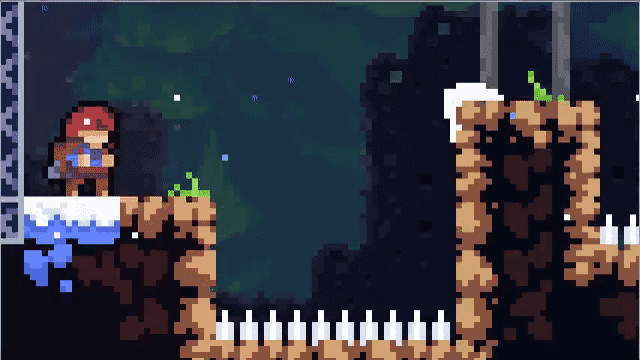

Figura 1. Coyote Timing en Celeste

#### 3.3.2. Objetos y power-ups

| Título                     | Descripción                                                                                        | Duración                                 | Obtención                                           |
|:---------------------------|:---------------------------------------------------------------------------------------------------|:-----------------------------------------|:----------------------------------------------------|
| **Globo pesado**           | Aumenta el peso del globo, haciendo que caiga más rápido hacia el campo rival.                     | 6 s (o hasta finalizar el punto)         | Aparición aleatoria en plataformas aéreas cada 20 s |
| **Dash (impulso)**         | Otorga 3 cargas de aceleración lateral rápida para interceptar el globo en trayectorias difíciles. | 3 usos (hasta consumirse o durante 10 s) | Zona central del mapa tras 5 rebotes consecutivos   |
| **Calzado antideslizante** | Vuelve el suelo resbaladizo para el adversario, mientras el portador conserva la tracción normal.  | 8 s                                      | Plataformas inferiores cada 25 s                    |

### 3.4. Físicas y dificultad

- **Gravedad y salto:** Los jugadores cuentan con una gravedad constante
  y predecible que permite controlar los saltos y el movimiento aéreo
  con precisión. El sistema incorpora *Coyote Time*, con una ventana de
  0,2 segundos tras abandonar una plataforma para permitir saltos desde
  sus bordes. El globo presenta una caída más lenta y una trayectoria
  influida por la gravedad y la resistencia al aire.
- **Colisiones:**
  - **Con plataformas:** Los personajes y el globo interactúan con los
    límites sólidos del escenario. Algunas plataformas permiten
    atravesarlas desde abajo y aterrizar sobre ellas.
  - **Entre jugadores:** La interacción física evita bloqueos injustos y
    permite disputar el espacio bajo el globo sin que los empujones
    decidan directamente la partida.
  - **Con el globo:** Los golpes modifican su trayectoria mediante un
    impulso cuya dirección depende del punto de contacto. Si el globo
    toca el suelo o un obstáculo letal, se aplica la condición de
    derrota correspondiente.
- **Rebotes, fricción y empujes:** El globo rebota contra paredes y
  techos, modificando su trayectoria según el ángulo y la velocidad del
  impacto. La fricción de los personajes permite controlar las frenadas
  y los cambios de dirección.
- **Plataformas móviles y superficies especiales:** Las plataformas
  móviles y las superficies con propiedades físicas especiales pueden
  modificar las rutas de movimiento y las trayectorias del globo. Estos
  elementos añaden variables que los jugadores deben considerar al
  posicionarse e interceptar.
- **Progresión de la dificultad:** Cada golpe consecutivo aumenta el
  multiplicador de velocidad del globo en +0,2x, desde 1,0x hasta un
  máximo de 10,0x. Esto reduce progresivamente el tiempo de reacción y
  exige anticipar las trayectorias y los rebotes. Si el globo cae o
  explota, el multiplicador vuelve a su valor inicial.

### 3.5. Escenario

El escenario representa la cámara de pruebas principal del laboratorio
del excéntrico Doctor Inflatus, una arena competitiva de pantalla fija
con estética retrofuturista, repleta de maquinaria científica, bobinas
de energía y tuberías de helio. Pip y Beto se enfrentan en un duelo de
supervivencia donde deben mantener el globo en el aire y desviarlo hacia
el sector rival para provocar errores y agotar las vidas del oponente.

## 4. Narrativa

### 4.1. Historia

En las profundidades del laboratorio subterráneo del excéntrico Doctor
Inflatus, un experimento destinado a condensar energía pura se sale de
control: la sustancia ultra volátil Helio-X queda atrapada dentro de un
frágil globo de látex. Al activarse el protocolo de emergencia, las
compuertas blindadas sellan la cámara de pruebas, dejando atrapados a
dos empleados del complejo: Pip, el torpe y nervioso asistente
científico, y Beto, el conserje todoterreno del laboratorio.

El sistema de contención activa un protocolo experimental de
supervivencia: el globo debe permanecer en el aire y ser desviado hacia
el sector opuesto antes de que toque el suelo o detone. Cada fallo
compromete la seguridad del sector correspondiente. Sin posibilidad de
escapar ni tiempo para buscar otra solución, Pip y Beto se ven obligados
a competir por su supervivencia, utilizando las plataformas, las paredes
y sus reflejos para mantener el globo fuera de su territorio y provocar
errores en su rival.

Lo que comienza como una prueba de reflejos se convierte en un duelo
frenético donde cada golpe aumenta la velocidad del globo y cada rebote
puede cambiar el rumbo de la partida. Solo quien consiga conservar al
menos una vida podrá superar el protocolo, desbloquear la salida y
escapar del laboratorio antes de que el experimento alcance su punto
crítico.

### 4.2. Personajes

#### Pip (jugador 1)

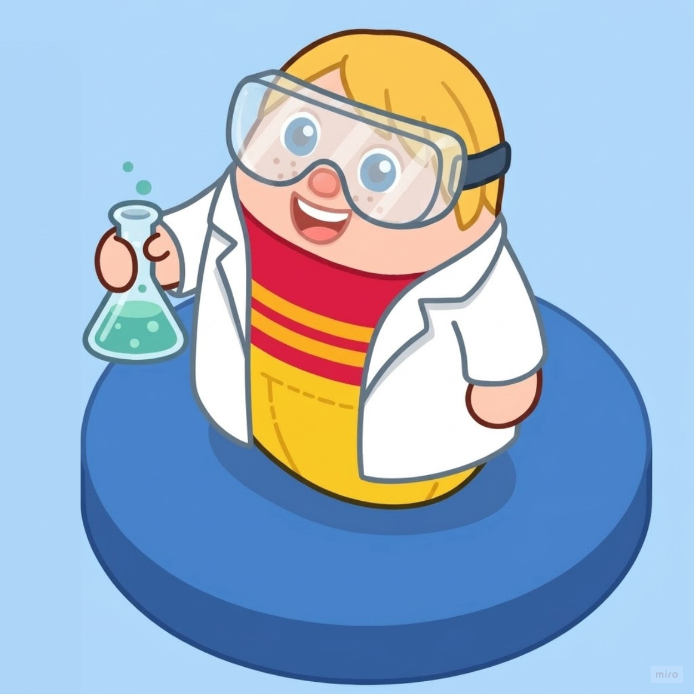

Figura 2. Jugador 1 (Pip)

- **Edad y origen:** 20 años, asistente de laboratorio júnior originario
  de Nueva Neumática.
- **Personalidad:** Neurótico, calculador y propenso al pánico bajo
  presión, aunque sumamente metódico.
- **Motivación:** Sobrevivir al colapso del experimento y demostrarle al
  Doctor Inflatus que merece un ascenso.
- **Trasfondo:** Contratado recientemente como becario de investigación,
  Pip pasa sus días calibrando válvulas de presión y limpiando los tubos
  de ensayo del complejo subterráneo antes del accidente con el Helio-X.

#### Beto (jugador 2)

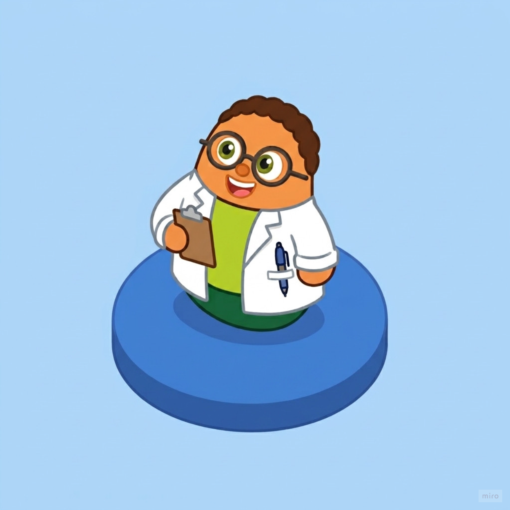

Figura 3. Jugador 2 (Beto)

- **Edad y origen:** 40 años, jefe de mantenimiento e intendencia del
  complejo subterráneo.
- **Personalidad:** Tranquilo, pragmático, sarcástico y con reflejos
  curtidos por años de resolver problemas al instante.
- **Motivación:** Salir ileso de la cámara de pruebas para terminar su
  turno laboral y llegar a cenar a casa.
- **Trasfondo:** Veterano de mantenimiento que conoce cada rincón y
  cableado del laboratorio. Se encontraba encerando el suelo de
  contención justo cuando la alarma de emergencia selló los accesos con
  el globo suelto.

#### Doctor Inflatus (personaje no jugable)

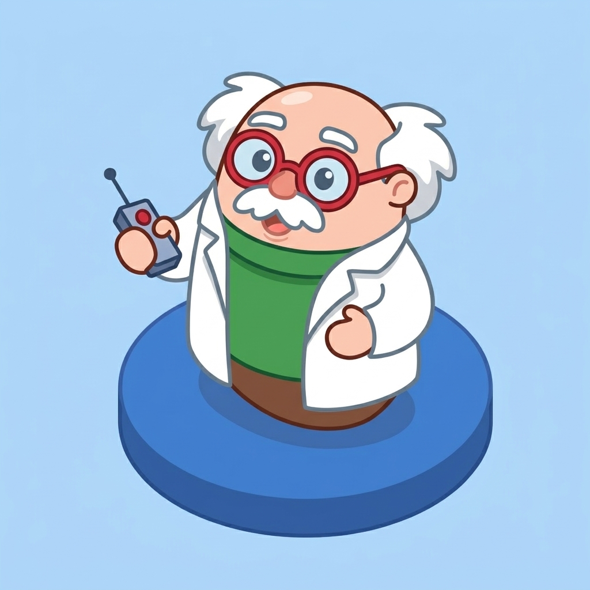

Figura 4. Doctor Inflatus

Científico excéntrico y creador de la sustancia Helio-X. No participa
físicamente en la arena, pero supervisa el duelo a través de los
monitores blindados de la cámara de pruebas. Su voz interviene por
megafonía anunciando la cuenta atrás, la aceleración de las partículas y
la activación aleatoria de los potenciadores en el mapa.

## 5. Imagen y diseño visual

### 5.1. Logotipo

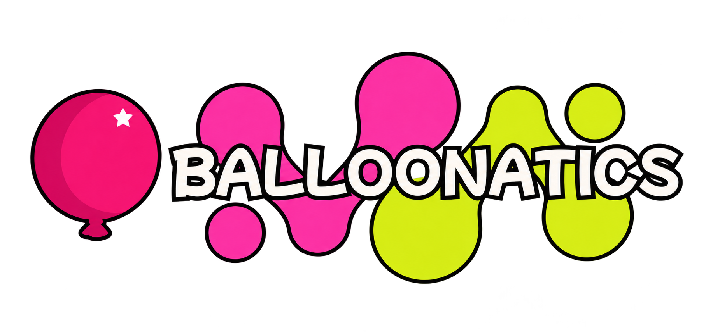

Figura 5. Logotipo Balloonatics

### 5.2. Estilo visual

El juego utiliza un estilo **cartoon 2D de trazo grueso y colores
saturados** que refuerza la identidad desenfadada y frenética de la
jugabilidad competitiva. Este tratamiento gráfico estilizado y de alto
contraste permite que los personajes, las plataformas y, especialmente,
la trayectoria del globo destaquen con claridad sobre el fondo del
laboratorio durante los momentos de máxima velocidad.

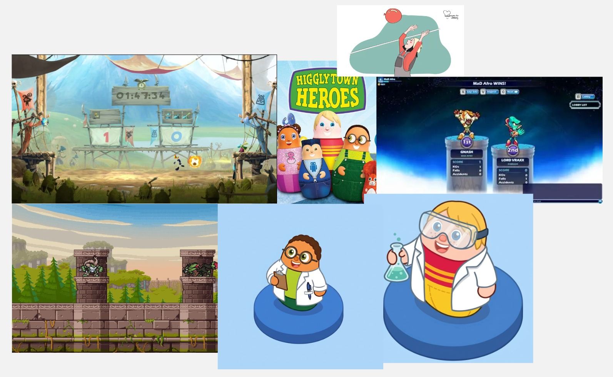 

Figura 6. Mockup

### 5.3. Uso de colores

- **Fondo (`#1B1F3B`):** Azul oscuro y tonos pizarra metálicos
  desaturados que representan las paredes y la maquinaria del
  laboratorio, garantizando que el primer plano resalte con nitidez.
- **Jugadores (`#E94560` y `#0F9BD7`):** Colores complementarios para
  distinguir fácilmente a cada jugador. Pip utiliza tonos rojos y
  anaranjados, mientras que Beto viste tonos azules y cian.
- **Objetos (`#F5C518`):** Amarillo brillante y dorado para el globo
  energético, los indicadores de alerta y las cajas de *power-ups*.

Figura 7. Paleta de colores a usar

### 5.4. Cámara y representación

- **Representación:** 2D, vista lateral.
- **Cámara:** Fija, mostrando todo el escenario en una única pantalla.
- **Resolución base:** 1920 × 1080 píxeles.

### 5.5. Inspiración artística y cultural

- **TowerFall Ascension:** Tomamos como referencia la legibilidad de las
  arenas cerradas de pantalla fija, el ritmo frenético de los saltos y
  la claridad espacial del plataformero 2D \[1\].

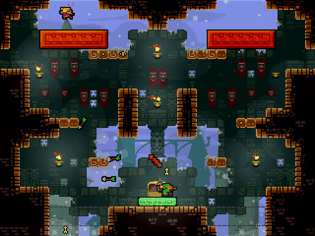

Figura 8. TowerFall Ascension

- **El laboratorio de Dexter y la animación slapstick de Cartoon
  Network:** Inspiración para la estética retrofuturista de laboratorio
  caricaturesco, con maquinaria exagerada, colores saturados, contornos
  marcados y comedia física basada en el caos \[2\].

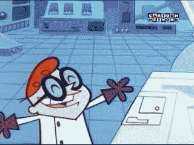

Figura 9. Laboratorio de Dexter

- **«Que no caiga el globo» / Keepy Uppy:** El reto de perseguir y
  golpear un objeto ligero para evitar que toque el suelo,
  reinterpretado como un duelo competitivo dentro de un entorno
  científico inestable \[3\].

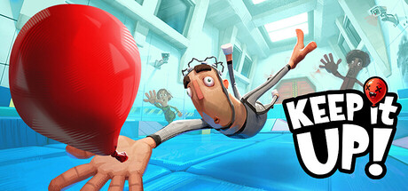

Figura 10. Keepy Uppy

### 5.6. Bocetos de personajes y pantallas

Los bocetos de los personajes se añadirán en el apartado
[Personajes](#42-personajes), y los de las pantallas en el apartado
[Pantallas](#71-pantallas).

## 6. Sonido

### 6.1. Banda sonora

| Pista                | Escena           | Estilo/ambiente                                                                                                            | Fuente/licencia       |
|:---------------------|:-----------------|:---------------------------------------------------------------------------------------------------------------------------|:----------------------|
| Tema del laboratorio | Menú principal   | Jazz/funk retro cómico con sintetizadores ligeros, tempo medio (110 BPM), distendido y alegre.                             | CC0 (dominio público) |
| Helio frenético      | Partida          | Electro-swing acelerado con percusión enérgica (140 BPM), aumentando sutilmente de tono según sube la velocidad del globo. | CC BY 4.0             |
| Fin del experimento  | Victoria/derrota | Jingle breve de fanfarria cómica para el vencedor y sonido de trombón caricaturesco para la derrota.                       | CC0 (dominio público) |

### 6.2. Efectos de sonido

| Efecto                 | Se reproduce cuando...                                                             |
|:-----------------------|:-----------------------------------------------------------------------------------|
| Salto                  | Se pulsa la tecla de salto.                                                        |
| Golpe al globo         | El jugador colisiona con el globo.                                                 |
| Recoger objeto         | El jugador entra en contacto con una caja de *power-up* o activa una bonificación. |
| Botones de la interfaz | El cursor pasa sobre un botón o se hace clic.                                      |
| Cuenta atrás           | Durante los tres segundos previos al inicio de la ronda.                           |
| Explosión del globo    | El globo toca el suelo o la zona de fallo.                                         |
| Activación de Dash     | Se consume una carga de impulso lateral.                                           |

## 7. Interfaz y diagrama de flujo

### 7.1. Pantallas

#### 7.1.1. Arte principal y logo

Figura 11. Pantalla con el logotipo del juego

#### 7.1.2. Menú principal

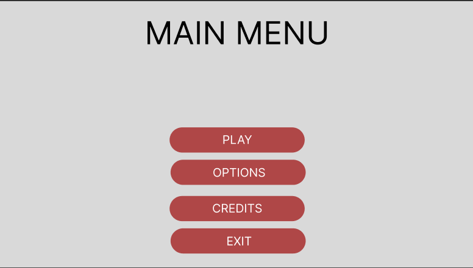

Figura 12. Pantalla de menú principal 

#### 7.1.3. Selección de mapa

Figura 13. Pantalla de selector de mapas

#### 7.1.4. Selector local y online

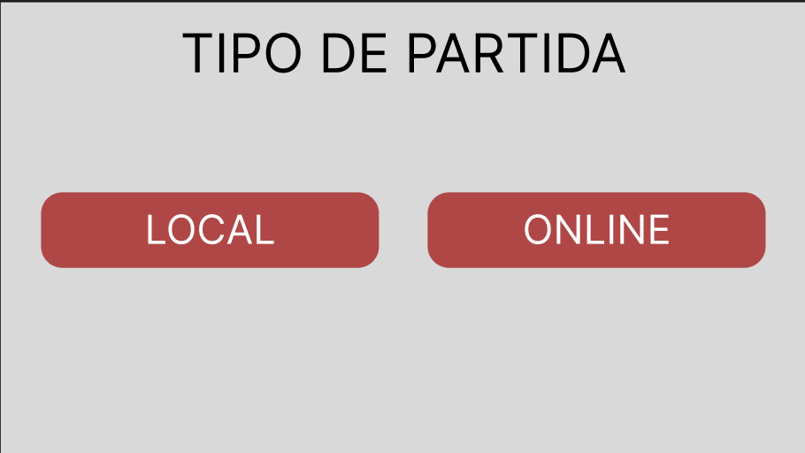

Figura 14. Pantalla de selección de modo local/online

#### 7.1.5. Gameplay

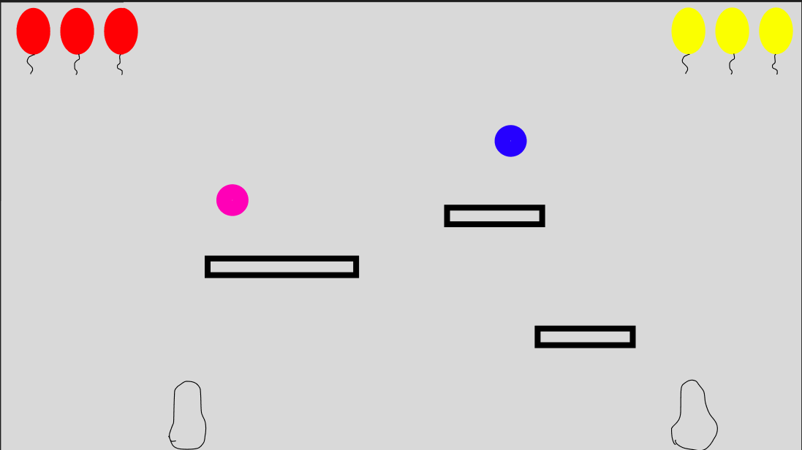

Figura 15. Pantalla de gameplay

#### 7.1.6. Resultado

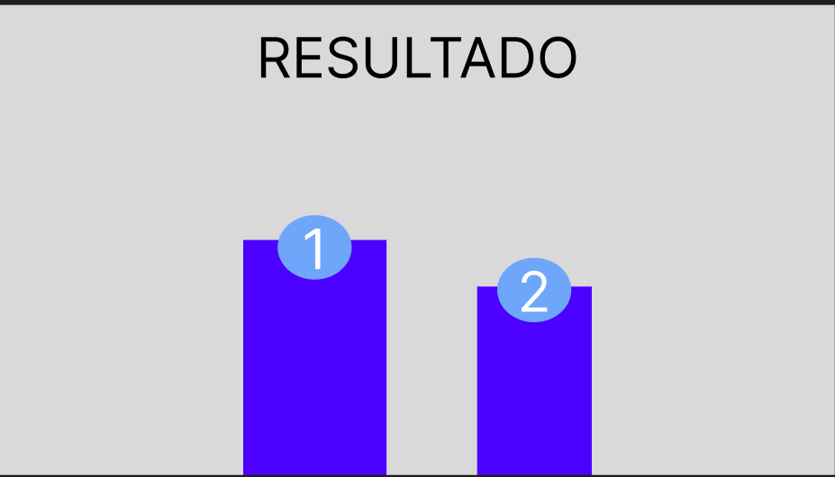

Figura 16. Pantalla de resultado

#### 7.1.7. Pausa

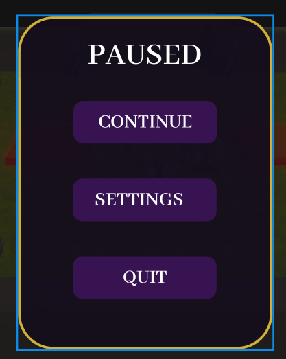

Figura 17. Pantalla de pausa

#### 7.1.8. Opciones

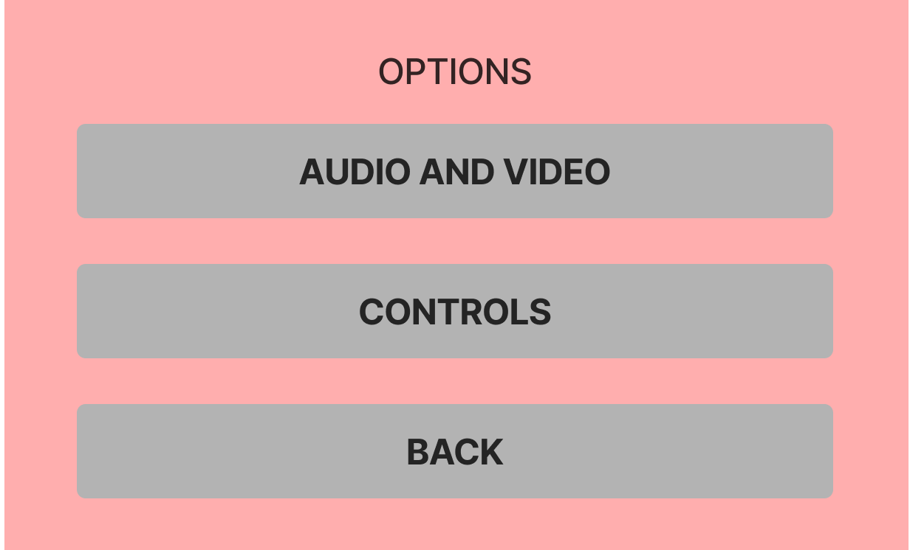

Figura 18. Pantalla de opciones

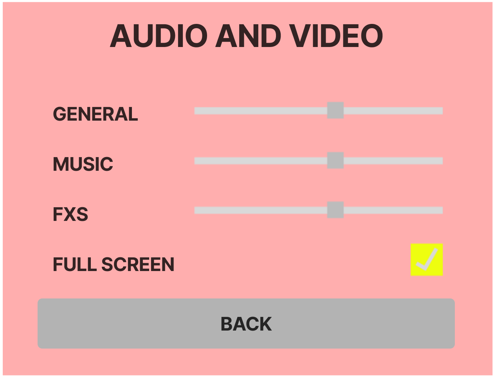

Figura 19. Pantalla de opciones

#### 7.1.9. Salir

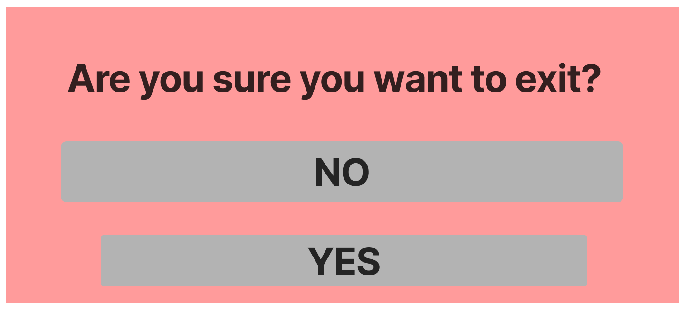

Figura 20. Pantalla de salida

#### 7.1.10. Créditos

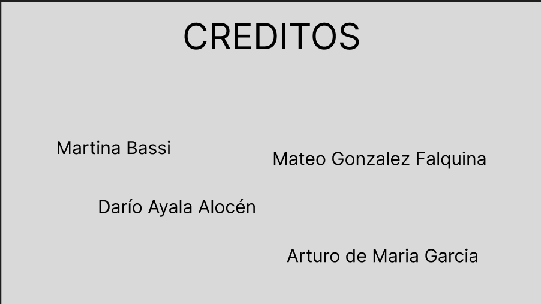

Figura 21. Pantalla de créditos

### 7.2. Diagrama de flujo

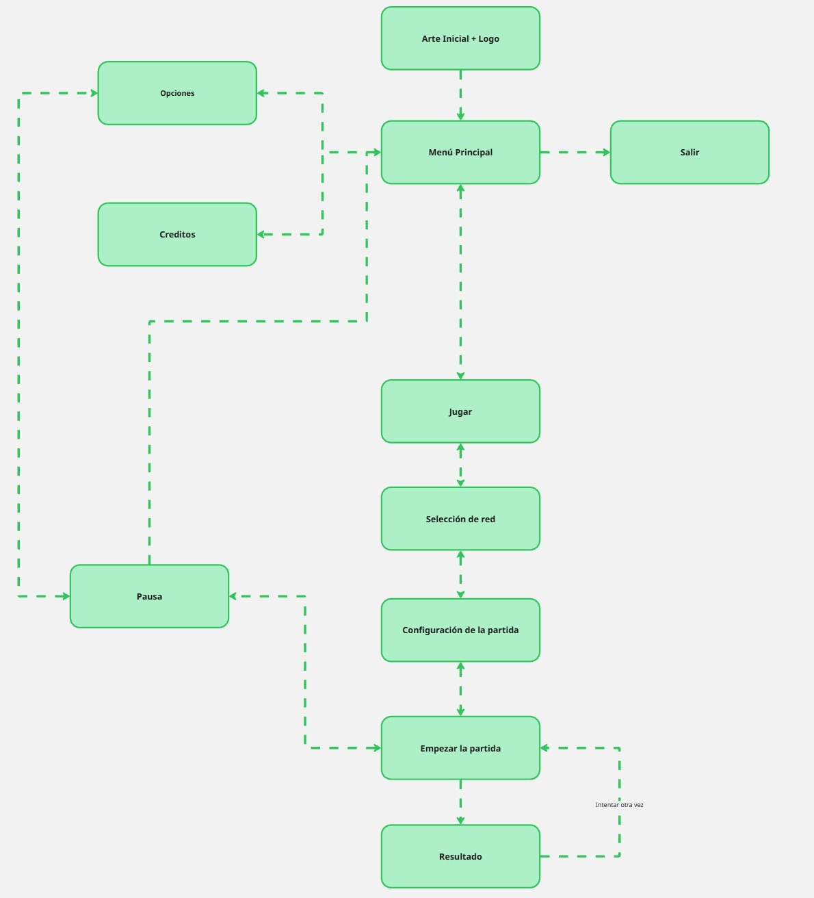

Figura 22. Diagrama de flujo de Balloonatics

## 8. Comunicación y marketing

- **Público y mensaje clave:** Jóvenes y adultos jóvenes aficionados a
  los *party games* competitivos locales y de navegador. El mensaje
  clave destaca la tensión inmediata, el pique entre rivales y la
  diversión caótica: *un reto simple de entender, frenético de jugar y
  donde cada toque al globo puede sellar tu derrota*.
- **Canales:** Redes sociales dinámicas, comunidades de desarrollo indie
  en Discord y Reddit, y plataformas de distribución web indie como
  [itch.io](https://itch.io/), [Newgrounds](https://www.newgrounds.com/)
  y [Game Jolt](https://gamejolt.com/).
- **Calendario:**
  - **Teaser:** Octubre de 2026, presentación del concepto visual, los
    personajes y el logo en redes.
  - **Devblog semanal:** Noviembre de 2026, avances de físicas,
    arquitectura cliente-servidor y pruebas multijugador.
  - **Lanzamiento:** Diciembre de 2026, publicación de la versión
    multijugador jugable en la web.
- **Material:** Tráiler dinámico de 30 segundos centrado en rebotes
  rápidos, capturas de la arena del laboratorio, GIFs de jugabilidad que
  destaquen el *Coyote Time* y los *power-ups*, y un *press kit* digital
  con logotipo, recursos gráficos y sinopsis.
- **Eslogan:** «¡Rebota, esquiva y que no caiga de tu lado!»

## 9. Referencias

1.  Thorson, M. (2013). *TowerFall Ascension*. Matt Makes Games.
    \[https://www.towerfallgame.com\].
2.  Tartakovsky, G. (1996). *Dexter's Laboratory* \[serie de
    televisión\]. Cartoon Network Studios / Hanna-Barbera.
3.  Referencia cultural: juego popular «Que no caiga el globo» / *Keepy
    Uppy*.
4.  Schell, J. (2019). *The Art of Game Design: A Book of Lenses* (3.ª
    ed.). CRC Press.
